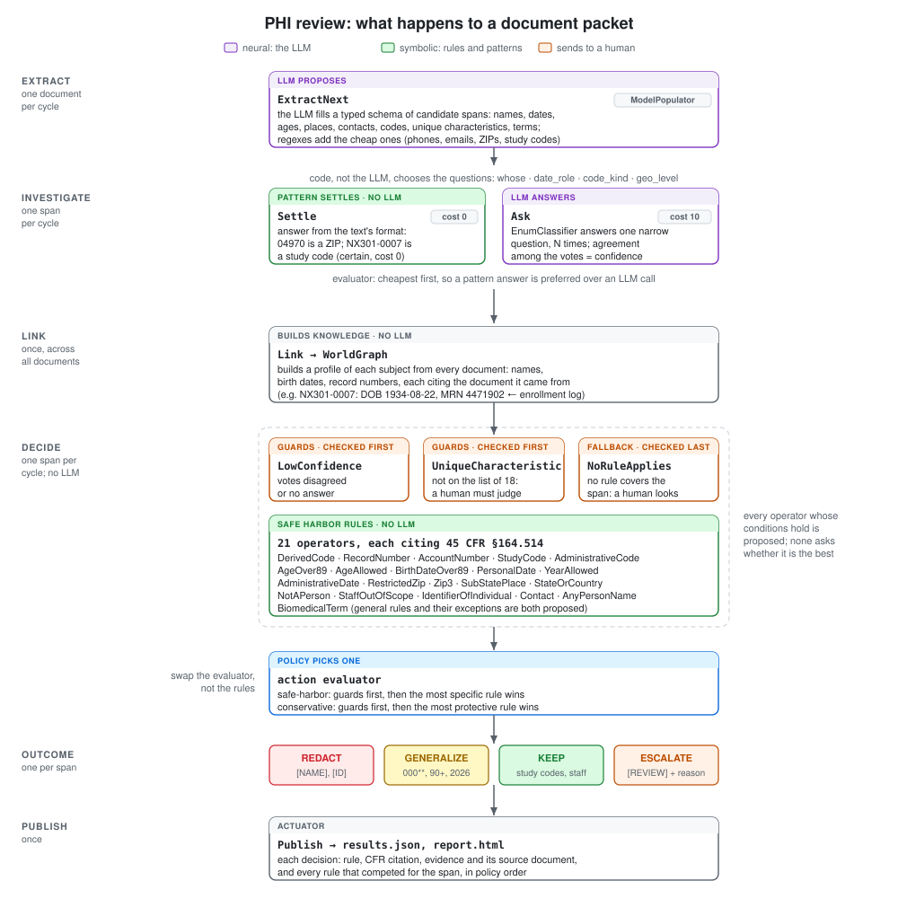

# Technical Approach

This demo reviewer is built with [`cognition`](https://github.com/polycog/cognition), a library for building neurosymbolic agents. It addresses the problem described in [the use case](usecase.md): finding and treating the protected health information (PHI) in a clinical-trial packet under HIPAA Safe Harbor, accurately and with decisions that can be audited.

## Approach

The reviewer splits the work between two kinds of reasoning:

- **Neural: reading the text.** An LLM proposes candidate spans (names, dates, places, codes and so on) and answers narrow questions about each one, as typed values: *whose name is this?*, *what is this the date of?*, *what does this code label?*, *what kind of place is this?* Each question is asked several times; the share of votes that agree is the answer's confidence.
- **Symbolic: applying the regulation.** Code decides which questions to ask, links what was learned into a profile of each trial participant across all documents, and applies the Safe Harbor rules as `cognition` operators. No LLM is involved in these steps, so the same answers always lead to the same decision, and every decision can be traced.

The rest of this page covers the packet, a worked example, the decision process, how rules and policies interact, and when a span goes to a human.

## The packet: `corpus/`

Four short synthetic documents from a fictional Phase 2 study, NX-301:

| Document | What it contains |
|---|---|
| `01_enrollment_log.txt` | Participants with names, birth dates, medical record numbers and contacts |
| `02_sae_narrative.txt` | A serious-adverse-event narrative: age, town, ZIP, relatives, investigator, specimen labels |
| `03_monitoring_note.txt` | A monitoring visit: staff names and site dates |
| `04_sample_manifest.txt` | Central-lab sample IDs, collection dates and a shipment date |

`corpus/gold.json` holds the expected treatment of 50 spans, each with its reason and the trap it tests.

### The traps: where reading the text is not enough

| Situation | Why a single prompt struggles | What `cognition` does |
|---|---|---|
| `03608` vs `04970` | Whether a ZIP keeps its first 3 digits depends on a **population table** | `RestrictedZip`/`Zip3` rules consult the HHS list (`reference.py`) |
| `EM-19340822`, `4471902-LFT1` | These look like ordinary sample IDs. They are built from a birth date and an MRN that appear **only in another document** | Link builds participant profiles in a `WorldGraph`; `DerivedCode` checks every code against them, and cites where each fact came from |
| `1934-08-22`, `91-year-old`, `92` | Over 89 even the **year** must go: that takes arithmetic against a reference year | `BirthDateOver89`, `AgeOver89` |
| `Dr. Priya Raman`, `Jamie Ortiz` | Safe Harbor covers the individual, relatives, employers and household, **not staff**. LLMs tend to redact every name | The general `AnyPersonName` rule and its exception `StaffOutOfScope` are both proposed; a **policy evaluator** picks one |
| `NX301-0007` | Random study codes are *permitted* re-identification codes (§164.514(c)) | `StudyCode` keeps them, but only if `DerivedCode` found nothing |
| `2026-06-18` (monitoring visit), `2026-03-05` (shipment) | Dates about the site or shipment are not about an individual; dates of admission or collection are | The LLM answers one narrow question, *what is this the date of?*, and a rule applies the regulation |
| `Wilson's disease`, `HeLa` | Names that are not people | `NotAPerson`, `BiomedicalTerm` |
| `1998 Boston Marathon finish at age 64` | Not on the list of 18, yet it identifies her and implies a 1934 birth year | `UniqueCharacteristic` **escalates** to a human, with the computed age as evidence |

## Example: a code built from another document

The adverse-event narrative mentions a specimen labeled `EM-19340822`. On its own it looks like an ordinary sample ID, and sample IDs assigned by a study are permitted. Here is how the reviewer handles it:

1. **Extract (neural).** From the enrollment log, the LLM proposes `Eleanor Marsh`, `1934-08-22` and `4471902` for participant `NX301-0007`. From the narrative, it proposes `EM-19340822` as a code.
2. **Investigate (neural, with patterns first).** `NX301-0007` is settled as a study code by its format alone, with no LLM call. The LLM is asked what `1934-08-22` is the date of (*birth*), and what `EM-19340822` labels (*a sample*).
3. **Link (symbolic).** The reviewer builds a profile of `NX301-0007`: name Eleanor Marsh, born 1934-08-22, MRN 4471902, each fact citing `01_enrollment_log.txt`.
4. **Decide (symbolic).** Two rules apply to `EM-19340822`:
   - `StudyCode` would keep it, since it labels a sample;
   - `DerivedCode` would redact it, because its digits contain the birth date of `NX301-0007` and its letters are her initials.

   Under the Safe Harbor policy the more specific rule wins, so the code is redacted as `[ID]`. The evidence reads: *contains birth date 1934-08-22 of NX301-0007 (learned from 01_enrollment_log.txt); starts with initials EM of Eleanor Marsh*. The trace also records that `StudyCode` competed and lost.

The birth date itself is caught the same way: `BirthDateOver89` computes an age over 89 against the reference year and removes the year too, outranking `PersonalDate`, which would have kept the year.

## The decision process



The root decision process runs one visible step per cycle, through five stages:

| Stage | What happens | LLM? |
|---|---|---|
| **Extract** | One document per cycle: the LLM fills a typed schema of candidate spans; regexes add the cheap ones | yes |
| **Investigate** | One span per cycle: a sub-process decides which questions apply to the span and answers each, by pattern when the format settles it, otherwise by asking the LLM *N* times | yes, when no pattern settles it |
| **Link** | Once, across all documents: builds a profile of each participant (names, birth dates, record numbers), each fact citing its source document | no |
| **Decide** | One span per cycle: a sub-process proposes every rule that applies, and a policy evaluator picks one | no |
| **Publish** | Writes `results.json` and `report.html`, with the full decision trace | no |

Investigating every span before deciding any of them is what makes cross-document reasoning possible: by the time a rule looks at `EM-19340822`, the birth date and MRN from the enrollment log are already in the graph.

## Rules and policies

Each Safe Harbor rule is an operator that states only whether it is *allowed* to decide a span, never whether it is the *best* rule. General rules and their exceptions are both proposed:

| Situation | General rule | Exception |
|---|---|---|
| Names | `AnyPersonName`: remove a person's name | `StaffOutOfScope`: keep staff names; `NotAPerson`: keep eponyms and cell lines |
| Codes | `StudyCode`: keep a study-assigned code | `DerivedCode`: remove it if it contains the participant's identifiers |
| Dates | `PersonalDate`: keep only the year | `BirthDateOver89`: remove the year too if it implies an age over 89 |
| ZIP codes | `Zip3`: keep the first three digits | `RestrictedZip`: replace them with `000` if the area has 20,000 people or fewer |

A **policy** is an action evaluator that ranks the competing rules. Swapping it changes the policy without touching a rule:

| Policy | How it ranks the rules that apply |
|---|---|
| `safe-harbor` | Guards first, then the most specific rule (Safe Harbor as written) |
| `conservative` | Guards first, then the most protective treatment (redact before generalize before keep) |

Because the rules stage needs no LLM, changing the policy reruns only that stage, in about 0.02 seconds:

```bash
uv run python -m pii_demo redecide --policy conservative --save-as out/conservative
```

## When a span goes to a human

The reviewer escalates a span, marking it `[REVIEW]` with the reason, in three cases:

- **`LowConfidence`:** the LLM's votes on a question the decision depends on agreed less than the threshold (60% by default), or it gave no answer.
- **`UniqueCharacteristic`:** a distinctive personal fact that is not on the list of 18, such as *"1998 Boston Marathon finish at age 64"*. Whether it identifies someone is a judgment Safe Harbor leaves to a person. The reviewer attaches what it can compute: that this implies a birth year around 1934, matching the date of birth on file.
- **`NoRuleApplies`:** no rule covers the span.

The guards outrank every rule, and the fallback ranks below every rule, under both policies.

## Results

Across five runs on four models, `cognition` scored 48–50/50 on every model; a single-prompt baseline using the same model and the same rulebook scored 20–47/50. The full comparison, including where each approach fails and the caveats, is in [the results summary](../out/summary.md).

The baseline is deliberately fair: `baseline.py` uses the same model *and the same rulebook*, including the restricted ZIP3 list, in one prompt per document. The comparison isolates process from knowledge.

## For developers

### How it maps onto the library

```
Cogent "phi-reviewer"         sensor: packet (reads corpus/)   actuators: say, publish
└─ root DecisionProcess       one visible step per cycle (pipeline.py)
   EXTRACT      ModelPopulator(Extraction)            ← LLM proposes typed spans; regexes add cheap ones
   INVESTIGATE  sub-DP assess/investigate.py          ← decides WHICH questions to ask about each span
                  Ask(question) ── EnumClassifier     ← LLM answers typed questions, N votes = confidence
                  Settle(question)                    ← pattern answers; evaluator prefers it (no LLM cost)
   LINK         WorldGraph: Mention, Subject, Document, InDocument, Concerns
   DECIDE       sub-DP assess/rules.py                ← no LLM: 24 Safe Harbor operators
                  guards: LowConfidence, UniqueCharacteristic → ESCALATE
                  policy evaluator: "most specific rule" (safe-harbor) | "most protective rule" (conservative)
   PUBLISH      actuator → results.json → report.html
```

### Code layout

```
pii_demo/
  __main__.py             CLI: check | run | redecide | report
  llm.py                  model selection (any Pydantic AI model)
  domain.py               typed vocabulary (DocEnums the LLM answers in), graph entities, Decision
  reference.py            restricted ZIP3 list, CFR citations, patterns
  extract.py              proposals: ModelPopulator + regex sensors, span resolution
  assess/investigate.py   sub-DP: which questions, asked how
  assess/rules.py         sub-DP: Safe Harbor rules + policy evaluators (POLICIES)
  pipeline.py             root DP + Cogent
  baseline.py             single-prompt LLM baseline
  score.py, report.py     scoring against gold.json, HTML report
corpus/                   synthetic packet + gold.json
```

See the [README](../README.md) for how to install and run the demo.
